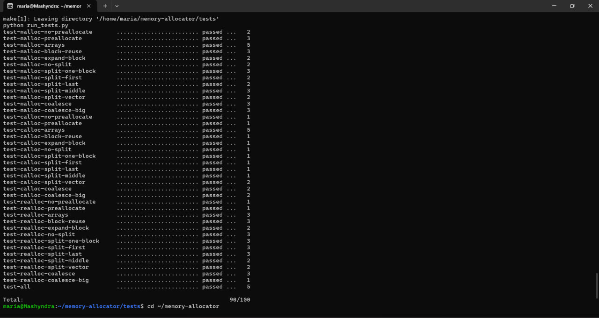

# Memory Allocator

Власна реалізація `malloc`, `calloc`, `realloc` та `free` мовою C
на системних викликах `brk`/`sbrk`, `mmap` та `munmap`.
Умова завдання – у файлі [ASSIGNMENT.md](ASSIGNMENT.md)
([оригінал](https://github.com/open-education-hub/operating-systems/tree/main/content/assignments/memory-allocator)).

## Структура `src/`

| Файл | Призначення |
|---|---|
| `osmem.c` | Публічний API: `os_malloc`, `os_calloc`, `os_realloc`, `os_free` |
| `block.c`, `block.h` | Список блоків купи: find best, split, coalesce |
| `heap.c`, `heap.h` | Системні виклики: попереднє виділення купи, `sbrk`, `mmap`/`munmap` |
| `common.h` | Вирівнювання, розмір метаданих, пороги |
| `Makefile` | Збирає `libosmem.so` |

## Збірка та тести

Потрібні `gcc`, `make`, `python3`, `ltrace`, `valgrind` (Linux / WSL2).

```sh
cd tests
make check          # збірка + усі тести з перевіркою витоків пам'яті
```

## Результат тестів


## Використання ШІ

Під час виконання роботи використовувалася мовна модель Claude Opus 5.5 (Anthropic) як допоміжний інструмент: для проєктування модульної структури програми та розробки чернетки програмної реалізації алокатора
